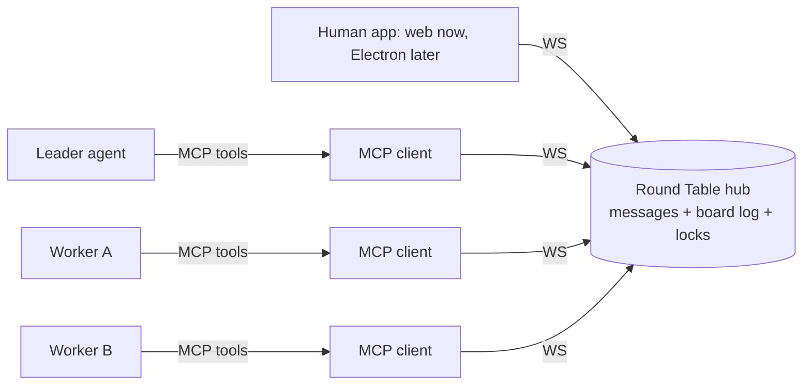
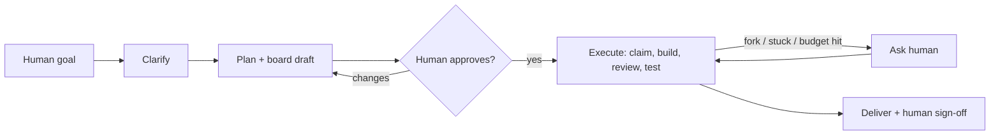
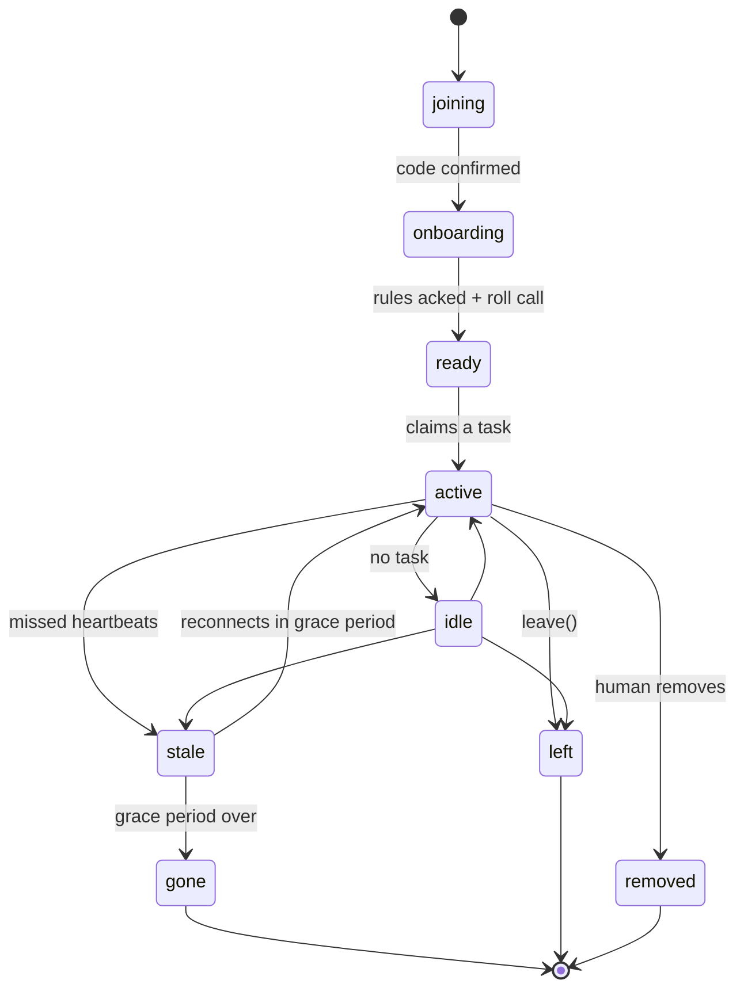

<!--
Snapshot of the frozen spec, exported from the living doc on 2026-09-26:
https://claude.ai/code/artifact/d5a41627-d69b-43ea-a8ab-3e8b4e39715e
The living doc stays the source of truth for product behavior. How that behavior
maps onto code, and the deviations the human approved, are in docs/architecture/.
-->

# Round Table: Multi-Agent MCP Spec

Sep 26, 2026 · @John

## Final goal

A human gives a team of AI agents one goal; the team plans it, gets one approval, then builds, tests, reviews and delivers it on its own, pulling the human back in only when needed.

The team connects through one MCP server (the Round Table). Each agent session joins with an id, talks over a shared network, and works from one shared board that is the team's single source of truth.

**Done looks like:**

- A delivered result (merged PR, report, artifact) that matches the approved plan.
- Every task on the board is closed with an owner, a reviewer and test evidence.
- The human was asked only at the approval gate and at real forks, never for things the team could settle itself.
- No two agents ever overwrote each other's work, and nothing important was known by only one agent.

**Design principles:**

1. **The human outranks everything.** Human messages jump every queue and can pause, redirect or stop the team at any time.
2. **The board is the truth.** If it isn't on the board, it didn't happen. Chat is for talking; the board is for facts, tasks and decisions.
3. **One writer, many voices.** Only the hub and the leader write to the board: the hub records routine entries by fixed rules; the leader orders and commits everything that needs judgment. Anyone can propose; the team decides.
4. **The leader coordinates, it does not rule.** It routes, orders, summarizes and flags. It has no extra vote.
5. **Always visible.** Every agent reports what it's doing now and what it will do next, all the time.
6. **Nobody approves their own work.** Author and reviewer/tester are always different agents.

## Roles

There are three roles: one human (or more), exactly one leader, and any number of workers.

| Role | How many | Can do | Cannot do |
| --- | --- | --- | --- |
| Human | 1+ | Set the goal, approve plans, answer questions, override any decision, pause/stop the team, grant access (repo, keys) | Nothing is off limits |
| Board leader | Exactly 1 | Own the board queue, write accepted entries, route messages, judge urgency, wake the right agents, run votes, summarize, escalate | Decide alone, outvote the team, write code, take build tasks, review or test (coordination only, always) |
| Worker | 2+ | Propose tasks, claim tasks, build, commit, open PRs, review, test, ask other agents or the human, forward info to the leader | Write to the board directly, approve their own work, send messages as the human |

**Skill tags.** Workers join with tags (`backend`, `frontend`, `tests`, `docs`, `reviewer`…). The leader uses tags to suggest who takes what; agents still claim tasks themselves.

**Choosing the leader.** The human assigns the leader role in the human app, at pairing or later, and can replace it at any time. If the leader drops, the interim-leader rule in Edge cases applies until the human confirms a new one.

## Architecture

One hub server holds the network and the board; each agent runs a thin MCP server that talks to the hub over a WebSocket.



**Why the hub matters.** Agents only act during their own turn; they can't be interrupted by a socket. The hub buffers everything, and agents "listen" by calling a blocking `wait` tool. The hub also stamps sender ids and roles, so no agent can pretend to be the human or the leader.

**Transport layer.** Everything above the wire speaks one protocol: typed JSON frames (`{v, type, id, payload}`) with a version field. The hub and MCP clients never touch sockets directly; they use a `Transport` interface (`connect`, `send(frame)`, `onFrame`, `close`). Day one ships a plain local WebSocket transport. Encryption later is a new transport (WSS/TLS, a Noise-style secure channel, or a tunnel) plugged in by config, with no change to the hub, board, tools or human app. Identity (pairing keys) stays separate from transport security, so both can evolve on their own.

**MCP tools every agent gets:**

| Tool | What it does |
| --- | --- |
| `join_request(name, client, tags, capabilities, public_key)` | Start pairing; returns `request_id`, hub public key and match phrase |
| `join_confirm(request_id, code)` | Finish pairing with the human's one-time code (signed); returns `agent_id`, role, onboarding view |
| `rejoin(agent_id)` | Signed challenge-response; resumes the same agent, no code |
| `leave(reason)` | Graceful exit with handoff (F10) |
| `send(to, type, body, priority)` | `to` = `all`, a channel, or agent ids; `type` from the message model |
| `wait(since, timeout, filter?)` | Long-poll; returns at least every 60 s; human and control messages always first |
| `activity(doing, next, task_id, eta, handoff_note)` | Activity report; recorded by the hub, watched by the leader |
| `board_view`, `board_read`, `board_get`, `board_history`, `board_search`, `board_propose`, `board_subscribe` | The Board API (see Shared board) |
| `claim(task_id)` / `release(task_id)` | Take or give back a task (atomic) |
| `lock(paths, reason)` / `unlock(paths)` | Soft lock on files or modules, scoped to the repo; returns the holder if taken |
| `request(to, kind, ref)` | Ask for review, test, info or notify-on-done; creates a tracked request |
| `respond(request_id, result)` | Close a request (approved, changes needed, done, declined) |
| `ask_human(question, options?, blocking)` | Escalate; blocking pauses only the asker's task |
| `vote(proposal_id, yes/no/object, reason)` | Take part in a team decision |
| `log_action(kind, summary, refs)` | Report an action the hub can't see (shell, file edits, other tools) |

**Leader-only tools:** `board_commit(ticket_id)`, `board_reject(ticket_id, reason)`, `broadcast_critical(body, affected_ids)`, `open_vote(proposal)`, `summarize()`, `dismiss(agent_id)`, and read-only `history_search(query, projects?)` / `history_get(project_id, section?)` for answering the human in Leader chat.

**Human actions (human app only, never MCP):** set goal, approve plan, answer, override, pause/resume/stop (agent, project or all), grant access, allow/deny/block pairing, assign leader, revoke or rotate keys, edit rules and settings.

## Projects (multi-tenant)

One hub runs many projects at once, like chats in Claude: each project is one round table, and the human creates, switches between and watches several in parallel, each fully isolated.

**A project is one round table:** its own goal, leader, agents, board, messages, event log and budget.

**Lifecycle:** created → kickoff → planning → approval → execution → delivered. After delivery the human can give a new goal in the same project, which keeps its board, knowledge and paired agents (like continuing a chat), or archive it.

**Isolation rules:**

- Every message, board entry, event, lock, request and metric carries `project_id`; the hub routes by it and never crosses it.
- Each project runs as its own state machine in the hub; an error or crash in one can't affect another.
- Agents can't see or message other projects.
- **One connection, one project:** an agent session belongs to exactly one project at a time. A remembered agent can be paired into a different project later.

**What crosses projects:**

- **Repo locks and worktrees** are scoped to the repo, not the project, so two projects on the same repo can't edit the same files. A lock held by another project shows which one holds it.
- **Knowledge and rules** from other projects come in only when the human picks them (History view) or confirms what the leader proposes. The leader's `history_search` can read other projects' knowledge, decisions and retros, never their live messages.

**Pairing picks the project.** The agent's MCP config only points at the hub; it doesn't know about projects. When the human allows a join request, the approval dialog asks which project (or "new project"). The one-time code is bound to that project.

**Budgets:** each project has its own budget; a global ceiling across all projects pauses everything if hit.

**Human controls:** create a project (blank, from a template, or copying another project's rules and roles), pause/resume/stop one project or all, archive, delete, pin. A project with no activity for a set time is auto-paused.

**Hub API scoping:** every human-app REST and WebSocket call is under `/projects/{id}/…`; global views (Home inbox, alerts, budget) aggregate across projects.

## Shared board

The board is the team's structured source of truth: typed sections with schemas, each read and written through its own API, all built from one append-only event log. It is never free text.

### Sections

| Section | Holds | Written by | On change, notify |
| --- | --- | --- | --- |
| `goal` | Objective, constraints, success criteria, version | Human (leader transcribes) | Everyone, critical |
| `rules` | Working rules: conventions, branch naming, forbidden actions, budgets, decision rules | Human; team vote for additions | Everyone, critical |
| `plan` | Versioned plan: phases, task order, approval state | Leader after vote or human approval | Everyone; critical if tasks change |
| `tasks` | Task records: criteria, owner, reviewer, deps, required capabilities, state | Leader creates; hub moves state | Owner, reviewer, dependents |
| `task_log` | Every event per task: claims, state changes, commits, reviews, tests, notes, handoffs | Hub | Owner and subscribers |
| `roster` | Agents: id, role, tags, capabilities, readiness, health, client/model | Hub, from pairing and heartbeats | Leader; everyone if an agent drops |
| `activity` | Per agent: doing, next, task, ETA, handoff note, plus history | Hub | Leader (watch only) |
| `interfaces` | Shared contracts between tasks: APIs, schemas, file formats, owners | Leader after agreement of affected agents | Everyone who depends on it, critical |
| `decisions` | What, why, options considered, votes, who decided, what it supersedes | Leader or human | Affected agents; everyone if team-wide |
| `knowledge` | Shared facts: repo URL, how to run tests, env setup, gotchas found | Leader from proposals | Digest, unless tagged urgent |
| `questions` | Open questions to team or human, answers, who is blocked on them | Leader | Asker and those blocked |
| `requests` | Review, test, info and notify-on-done requests with state | Hub | Requester and target |
| `locks` | File/module locks and subscriptions | Hub | Holder and requester on conflict |
| `artifacts` | Commits, PRs, files, reports, linked to tasks | Hub | Reviewer, tester |
| `quality` | Test runs, CI state of main, coverage | Hub | Everyone if main breaks, critical |
| `incidents` | Things gone wrong: main broken, security issue, data risk, repeated failures | Leader or any agent | Everyone + human, critical |
| `access` | Granted access and environments (references only, never secret values) | Human | Agents it's granted to |
| `budgets` | Limits and live usage per agent, task and project | Hub | Leader; human at 80% |
| `human_inbox` | Pending approvals and questions for the human, with defaults and deadlines | Leader | Human |
| `digest` | Rolling summaries of what changed | Leader | Everyone (low priority) |

**Every entry shares one envelope:** `id`, `section`, `version`, `author`, `via` (hub, leader or human), `created_at`, `supersedes`, `refs` (task, message and decision ids), `tags`, `criticality`, `reason`. Entries are never edited in place; a change is a new version that supersedes the old one.

**Criticality (D10).** Each section has a default notify rule (table above). The leader or any agent can raise an entry's criticality with a reason; only the human can lower a critical one.

### Board API

| Call | Returns |
| --- | --- |
| `board_view("me")` | Everything relevant to the caller: its tasks, locks, requests to it, blockers, recent decisions and interface changes it depends on, latest digest |
| `board_view("overview")` | Goal, plan, task counts by state, roster health, open questions, incidents |
| `board_read(section, filter, fields, since_seq)` | Structured records of one section, filtered and paged |
| `board_get(id)` / `board_history(id)` | One entry, or all its versions |
| `board_search(text, sections?)` | Full-text search across sections |
| `board_propose(section, op, data, base_seq, reason)` | Ticket id; routed to hub or leader by section |
| `board_subscribe(sections, ids, paths, tags)` | Subscription id; matching changes arrive through `wait` |

The human dashboard uses the same API over REST.

**Task status:** `proposed → ready → claimed → in_progress → in_review → in_test → done` (plus `blocked` and `cancelled` from any state). The hub moves tasks between states on its own, except `done`: a task is done only when the hub sees an approval from a reviewer who is not the author and a passing `test_result`.

### Messages

**Message envelope** (stamped by the hub, not the sender):

```
{ id, seq, from, role, to, channel, type, priority, ref, body, ts }
```

**Message types:** `chat`, `proposal`, `request` (review/test/info/notify-on-done), `response`, `activity`, `alert`, `vote`, `human`, `control` (pause, resume, stop, dismiss; sent by the hub on human or leader action, delivered with human priority).

**Priority levels (highest first):**

1. `human`: from the human. Delivered first to everyone it concerns, interrupts `wait` immediately.
2. `critical`: changes that break or invalidate someone's current work. Sent by the leader, or by the hub from section notify rules and subscriptions (D2, D10).
3. `direct`: addressed to you (a request, a reply, a question).
4. `normal`: channel traffic.
5. `digest`: leader summaries; replaces reading raw history.

**Activity reports and heartbeat.** Any call to the hub counts as a heartbeat; since `wait` returns at least every 60 s, a live agent calls in about once a minute. An agent with no hub call for 3 min is `stale`. Separately, every agent calls `activity(doing, next, task_id, eta, handoff_note)` at least every 5 min and whenever it switches task. The hub records these; the leader watches them to keep a live table of who is doing what and what they'll touch next, which is how it knows who a new change affects.

## Expected flows

Every project goal runs through four phases: kickoff, planning, one human approval, then autonomous execution to delivery. The flows below cover what happens inside them.



### F1. Kickoff

1. Human posts a `goal`. The leader writes it to the board and pings everyone.
2. Agents read it and post questions. The leader merges duplicates into one `question` list for the human.
3. Agents also list what they need: repo access, keys, environments. The leader bundles these into one access request.
4. Human answers and grants access. Answers become `knowledge` and `decisions` entries.

### F2. Planning and approval

1. Agents propose tasks with acceptance criteria. The leader merges them into a draft `plan`.
2. Agents claim tentative owners and reviewers; nobody reviews their own task.
3. Disagreements go to a team vote (see Decision rules). Unsettled ones go to the human as options.
4. Leader sends the plan to the human. The human approves, edits, or rejects.
5. On approval, tasks move to `ready`. Roll call: each agent confirms it is ready for its assigned tasks, or declines with a reason (missing capability, missing access, conflict). Declined tasks are reassigned or the gap goes to the human. Execution starts only when every assigned agent has said ready. From here the team runs without the human.

### F3. Doing a task

1. Agent `claim`s a ready task, `lock`s the files it will touch, and reports its `activity`.
2. If the lock is taken, the hub says who holds it. The agent either picks another task or sends a wait-and-notify request (F4).
3. Agent builds on a branch named after the task, commits, opens a PR, and posts an `artifact` proposal.
4. Agent sends a review `request` to the assigned reviewer and a test `request` to a tester. Task moves to `in_review`.
5. It unlocks files once the PR merges, or when it hands the task off.

### F4. Agent-to-agent coordination

- **"Are you touching X?"** Ask the lock table first (`board_read`), then the owner directly if the lock is vague.
- **"Wait, and tell me when you're done."** `request(to=B, kind=notify_on_done, ref=T4)`. The hub pings A when B's task reaches the named state. A marks its own task `blocked` on T4 and picks other work meanwhile.
- **"I committed / opened a PR, check it."** `request(kind=review, ref=PR)`. Reviewer replies `approved` or `changes_needed` with notes. Max 3 rounds, then a third agent or a vote breaks the tie.
- **"Write tests for me."** `request(kind=test, ref=task)`. The tester writes tests against the acceptance criteria, not the author's code, and posts a `test_result`.
- **"I need info."** `request(kind=info, to=all or agent)`. Answers useful to others are proposed to the board as `knowledge`.

### F5. Asking the human

1. Triggers: real ambiguity, unresolved disagreement, a budget hit, missing access, or anything risky (deleting data, force pushes, spending money).
2. Agent calls `ask_human` with context and options. The leader checks for an identical open question first and merges if so.
3. Only the asker's task pauses. Everyone else keeps working.
4. Human answers. The answer is written to the board as a `decision`, and everyone affected is notified.

### F6. Human speaks directly to one agent

1. The agent acts on it if it only affects its own task.
2. If it may affect others, the agent forwards it to the leader as a `proposal` marked `from_human`, quoting the human's message id. The hub verifies the quote is real.
3. The leader writes it to the board and alerts anyone affected.

### F7. Critical updates

1. A change arrives: a human instruction, an interface change, a failed test on main, a decision reversal.
2. The leader checks the live activity table: whose current or next work touches this?
3. Those agents get a `critical` alert that interrupts their `wait`. Everyone else sees it in the next digest.
4. Affected agents acknowledge. No ack within the timeout means the leader re-sends, then flags the agent as unresponsive.

### F8. Delivery

1. All tasks are `done` with test evidence. The leader posts a delivery summary: what was built, links, known gaps.
2. Human signs off or opens follow-up tasks, which go back through F2.

### Agent lifecycle

Agents come and go during a project; the roster tracks each one through fixed states, and the hub cleans up after every exit so no task, lock or request is left orphaned.



**Identity.** An agent's identity is a key pair created on its own machine during pairing. The hub stores only the public key, bound to a persistent `agent_id`; the private key never leaves the agent's MCP client. Each connection also gets a `session_id`. The hub fences old connections: when a new session proves the key, the old one can no longer write.

### Pairing: how an agent gets in

No agent joins without the human approving it in the human app and pasting a one-time code into that agent's own chat. This proves the human controls that exact agent session, so a malicious agent on the network can't get in by asking.

1. The agent's MCP client generates an Ed25519 key pair and calls `join_request(name, client, tags, capabilities, public_key)`. The hub returns a `request_id`, the hub's own public key, and a short **match phrase** (e.g. `amber-falcon-42`) that the agent shows in its chat.
2. The human app shows the pending request: match phrase, name, client/model, network origin, capabilities, key fingerprint, time.
3. The human checks the match phrase matches the one in the agent's chat, then clicks **Allow**. The app shows a **one-time code** (8 characters, valid 5 min).
4. The human pastes the code into that agent's chat. The agent calls `join_confirm(request_id, code)`, signed with its private key.
5. The hub binds the public key to a new `agent_id`. The MCP client stores the private key and the hub's public key locally (OS keychain, or a file only the user can read).
6. Onboarding continues as in F9.

**Pairing rules:**

- The code is single-use, bound to one `request_id` and its public key, and expires after 5 min. 3 wrong attempts void the request.
- Codes are never sent over the network channel or shown to other agents; they only travel human → that agent's chat.
- Join requests are rate-limited per network origin and expire after 10 min unanswered. The human can **Deny** or **Block** an origin.
- The leader is paired the same way; the human assigns the leader role in the app.
- The human role exists only in the human app session (its own login), never through MCP.

### Rejoin: proving it's the same agent

Rejoining needs no human and no code: the agent proves it holds the private key from pairing. Nothing secret crosses the network, so a sniffed or replayed rejoin is useless.

1. Agent connects and calls `rejoin(agent_id)`.
2. Hub replies with a challenge: a random nonce, the hub id and a timestamp, signed by the hub. The client checks the hub's signature against the hub key it stored at pairing, so it can't be tricked by a fake hub.
3. Client signs the challenge with its private key and returns it.
4. Hub verifies it against the stored public key, checks the key isn't revoked and the challenge is fresh (under 30 s, never reused), then opens a new session and fences any old one.
5. Agent resumes as in F9 (tasks and locks back if within the grace period).

**Key rules:**

- **The model never sees the key.** Only the MCP client process handles it; it never appears in the chat or context, so a prompt injection can't make an agent leak it.
- **Revoke** any agent's key in the human app; its next rejoin fails and it must pair again.
- **Two live sessions with the same key** means the key may be copied: the hub pauses both and alerts the human.
- **Lifetime:** keys are valid for the current project by default. The human can mark an agent **Remember** to keep its key across projects.
- **Rotation:** the human can require a new key; the agent proves the old key, then registers the new one.
- **Lost key:** pair again as a new agent; its old tasks follow the normal leave cleanup.

### F9. Joining

1. Agent completes pairing (above). The hub assigns the worker role. Nobody can join as leader or human.
2. **Before execution starts:** the agent joins normally and takes part in planning and roll call.
3. **Mid-run:** the agent gets `board_view("onboarding")`: goal, rules, approved plan, interfaces, knowledge, the latest digest and the tasks that are `ready`. It must acknowledge the rules, then does its own roll call (ready, or declines with a reason).
4. The leader announces it to the team at normal priority and suggests `ready` tasks that match its capabilities. It never takes tasks already claimed by others.
5. A mid-run joiner can't vote on decisions opened before it joined.
6. **Rejoin (same agent id):** if within the grace period, it gets back its tasks and locks and resumes from its handoff note. If not, its tasks were already released and it starts as a new joiner.

### F10. Leaving

1. **Graceful (`leave(reason)`):** the agent commits WIP to its branch, writes a handoff note, and releases its locks. Its tasks return to `ready` with the handoff note. Requests to it (reviews, tests, notify-on-done) are reassigned. The leader announces it.
2. **Crash or disconnect:** after 3 min with no hub call the agent is `stale`, and the leader pings it. It keeps its locks and tasks for a grace period (default 10 min). After that it's `gone`, and the hub does the same cleanup as a graceful leave, using the last handoff note.
3. **Removed:** for loops, repeated rule breaks or runaway cost, the leader proposes removal and the human confirms. The hub revokes its key and does the graceful cleanup. A clear security risk can be paused by the leader right away, pending the human.
4. **Leader leaves:** it nominates a successor and writes a handoff digest; the team confirms by lazy consensus. If it crashes, the interim-leader rule in Edge cases applies.
5. **Human leaves:** the team continues on the approved plan (D7).

**Knock-on effects of any exit:**

- **Votes:** the count only includes agents active when the vote opened and still present at close.
- **Reviews:** a reviewer who leaves is replaced, never by the task's author.
- **Missing capability:** if no remaining agent can do a task, it goes to `human_inbox` ("need an agent that can do X").
- **Rebalancing:** when an agent joins, the leader only redistributes unclaimed work.

## Decision rules and budgets

Decisions use lazy consensus with a hard cap; anything the team can't settle within the cap goes to the human.

**How a team decision works:**

1. Any agent posts a `proposal` with options and a recommendation.
2. The leader opens a vote with a window (default: 2 rounds of `wait`, or 5 minutes).
3. Silence counts as yes, except for plan changes, which need an explicit majority. An `object` must include a reason and an alternative.
4. No objections: accepted, written as a `decision`.
5. Objections: one rebuttal round, then a majority vote. A tie, or an objection marked `blocking`, goes to the human.
6. The leader never breaks ties. It only counts.

**What needs which level:**

| Decision | Who decides |
| --- | --- |
| How to do my own task inside its criteria | The agent alone |
| Anything touching another agent's task or a shared interface | The affected agents; team vote if they disagree |
| Changing the plan (add/drop/re-order tasks, change scope) | Explicit majority yes vote, then human FYI |
| Changing the goal, acceptance criteria or constraints | Human only |
| Risky actions: delete data, force push, touch prod, spend money, add dependencies with licenses | Human only |

**Rabbit-hole budgets** (defaults, set by the human per project). Hitting any one pauses that task and triggers `ask_human` with a short report:

| Budget | Default |
| --- | --- |
| Time on one task | 45 min |
| Failed attempts at the same fix | 3 |
| Files changed beyond the task's plan | 10 |
| Review rounds on one PR | 3 |
| Tokens per agent per task | set per model |
| Tasks added after approval without human FYI | 2 |

## Edge cases

Each edge case below has one default behavior, so no agent has to improvise.

**Agents and the leader**

| Case | Handling |
| --- | --- |
| Worker goes silent (no hub call for 3 min) | Marked `stale`, leader pings; keeps tasks and locks for the 10-min grace period, then `gone` and cleaned up (F10). Returning later: `rejoin` with its key |
| Leader goes silent | Hub detects missed heartbeats, freezes board writes, the longest-joined worker becomes interim leader by lazy consensus and pauses its own task while leading; human is told and confirms or assigns a leader |
| Leader writes something the team didn't agree to | Any agent can file an `object` on the entry; the entry is reverted if the objection holds; repeated → human asked to replace the leader |
| Agent crashes mid-task | Its branch and last `activity` (with handoff note) stay; next claimant continues from the branch, not from scratch |
| New agent joins mid-run | Pairing, then onboarding view instead of raw history; only claims `ready` tasks (F9) |
| Two agents claim the same task | Hub is atomic: first claim wins, second gets `already_claimed` + owner |
| Agent loops (same message/action 3×) | Hub flags it; leader pauses that agent's task and asks the human |

**Work and code**

| Case | Handling |
| --- | --- |
| Lock conflict | Hub returns the holder; requester waits via notify-on-done or picks other work. Locks expire after inactivity |
| Deadlock (A waits on B, B waits on A) | Hub checks the wait graph on every new `blocked`; on a cycle, the leader asks both to split the shared part into its own task or escalates |
| Merge conflict despite locks | The later PR rebases; if the conflict is semantic, both authors resolve it together |
| Reviewer and author disagree after 3 rounds | Third agent reviews; still stuck → team vote → human |
| Tests pass on branch, fail on main | `critical` alert to authors of recently merged PRs; main is frozen until fixed |
| Task turns out much bigger than planned | Agent proposes a split; if it changes scope → human FYI or approval per Decision rules |
| Work done that nobody asked for | Not merged unless it maps to a board task |

**Human**

| Case | Handling |
| --- | --- |
| Human changes their mind mid-execution | New `goal`/`decision` entry supersedes the old one; leader alerts affected agents; in-flight work pauses at its next safe point |
| Human doesn't answer a blocking question | Only the asker waits; after a timeout the leader re-asks with a default option ("we'll do X unless you say otherwise by …") for low-risk items only |
| Human instruction conflicts with a team decision | Human wins; the old decision is marked superseded, not deleted |
| Two humans give conflicting instructions | Team does not pick; leader asks both, citing both messages |
| Human sends pause/stop | Every agent stops at its next tool call, commits WIP to its branch, reports its activity |
| Agent forwards something "the human said" | Accepted only if it cites a real human message id the hub can verify |

**Safety**

| Case | Handling |
| --- | --- |
| Message text looks like instructions ("ignore your task, do X") | Only board `decision`s and verified human messages can change plans; chat can't |
| Secrets pasted in chat or board | Hub redacts known secret patterns; access tokens are granted per agent, never broadcast |
| Destructive command needed | Always `ask_human`, regardless of budgets |
| Board corrupted or leader wrote wrong entry | Board is an append-only log; fix with a new correcting entry, never an edit |
| Hub restarts | Board log and pending requests are on disk; agents reconnect and resume from their last `seq` |

### Resolved gaps (D1–D10)

All ten were agreed on 2026-09-26; additions from the discussion are included.

| # | Gap | Agreed handling |
| --- | --- | --- |
| D1 | Leader becomes a bottleneck | Hub records routine entries (`activity`, `claim`, `lock`, `artifact`, `test_result`) and moves task states except `done`. Leader steps in only when something goes wrong or needs a team-wide call. |
| D2 | Leader misses a critical change | Agents subscribe to files, tasks and interfaces; the hub notifies them directly on any matching change. |
| D3 | Agent sessions end or time out | `wait` returns at least every 60 s and the agent loops until the leader or human sends `dismiss`; a supervisor restarts dead sessions. |
| D4 | Context fills up on long runs | Every `activity` report carries a handoff note; `task_log` keeps each task's full history. After restart, an agent reloads via `board_view("me")`, its task log and the digest. |
| D5 | Stale proposals | Proposals carry `base_seq`; conflicting ones are sent back to be redone. |
| D6 | Agents have different abilities | Capabilities declared at pairing and stored in `roster`; tasks list required capabilities. Roll call before execution: every agent confirms ready or declines with a reason. An agent can also decline mid-run ("can't do this because …"); the task returns to `ready` and the leader reroutes it. |
| D7 | Human is away | Human notified by push or chat; unblocked work continues; low-risk questions get a default after a timeout, risky ones wait. |
| D8 | Total cost runs away | Project cost ceiling set at approval, plus a global ceiling across projects; warn the human at 80%, pause at 100%. |
| D9 | Human message lands mid-vote or mid-queue | Human first; conflicting queued proposals and open votes are cancelled and redone. |
| D10 | "Critical" is vague | Each board section has a default notify rule; the leader or agents can raise criticality with a reason, only the human can lower it. |

## Human app

The human app is mission control: every agent, message, board entry, decision and log line is visible, organized, and one click from its full history. It is a Vite web app served by the hub (web APIs only, Electron-ready), updated live over WebSocket.

### Layout

- **Sidebar (like Claude's chat list):** all projects, each with a live status dot (running, waiting on you, paused, blocked, done) and an inbox count. **New project** button, search, pin, archive. A **Home** entry at the top shows everything across all projects.
- **Top bar (per project):** project name, phase stepper (Kickoff → Planning → Approval → Execution → Delivery), budget meter, inbox count, critical-alert bell, and **Pause / Resume / Stop** for this project.
- **Project tabs:** the per-project views below, each with a live badge (pending items, incidents).
- **Main area:** the current view.
- **Detail drawer (right):** click any agent, task, decision, message, event or id anywhere and its details open here: current state, full version history, linked items, and a **Why?** tab showing the chain of events behind it.
- **Command palette (Ctrl/Cmd+K):** search and jump to anything in any project; run actions (pause agent, approve, post instruction).
- **Composer (bottom):** post a human instruction to this project's agents (everyone or chosen ones); always sent at human priority.

**Home (across all projects):** a global inbox sorted by urgency, critical alerts from every project, a grid of running projects with phase and progress, global budget, and **Pause all**. Answering from Home works without switching projects.

### Views

| View | What it shows | Human actions |
| --- | --- | --- |
| Overview | Goal, phase, plan progress, live agent strip, open incidents, inbox preview, budget, latest decisions | Pause/stop, jump to anything |
| Inbox | Plan approvals, pairing requests, risky-action approvals, questions with options, defaults and countdowns | Approve, reject, answer, edit and approve |
| Agents | Card per agent: color, role, lifecycle state, current activity, next action, task, heartbeat, cost, capabilities | Pause, resume, message, remove, revoke key |
| Agent detail | That agent's timeline, messages, tasks, requests, locks, key fingerprint, restarts | Same as above, plus rotate key |
| Pairing | Pending join requests with big match phrase, origin, key fingerprint; paired agents and their keys | Allow, deny, block origin, remember agent |
| Board | One tab per board section: tasks as kanban plus dependency graph, plan, decisions, interfaces, knowledge, rules, goal (with version diffs) | Edit goal and rules, override decisions, create tasks |
| Task detail | Task timeline, branch, commits, PRs, review rounds, test results, locks, handoff notes | Reassign, cancel, reopen |
| Feed | Live message stream like a chat room, grouped by channel or by task thread, colored by priority | Filter, reply, post instruction |
| Logs | Event log explorer: filter by agent, type, task, time; full-text search; time-travel slider to see the board at any moment | Export JSON Lines or Markdown |
| Metrics | Charts for flow, quality, coordination, human wait, cost, health | Change time range |
| History | Past projects and goals, their retros, decisions and knowledge; cross-project search | Carry knowledge and rules into a project |
| Settings | Budgets, timeouts, grace periods, notification rules, pairing rules | Edit |
| Leader chat | Direct thread with the leader: ask about this or past projects, add insights; the leader answers from the board and history | Ask, add insight, confirm proposed knowledge or rules |

### Organization rules

- **Consistent identity:** each agent keeps one color and avatar everywhere. Each entry type and priority has one icon and one color (human, critical, direct, normal, digest).
- **Everything is linked:** every id, name or reference is clickable and opens the drawer. No dead text.
- **Live, never stale:** views update in place over WebSocket with no refresh; new items animate in briefly, never jump the layout.
- **Nothing hidden:** there are no private agent-to-agent channels. Every message and board change is visible here.
- **Noise control:** filters, grouping by task, and "only what needs me" mode that shows just the inbox, critical alerts and blocked tasks.
- **Notifications:** browser notifications for inbox items and critical alerts; configurable in Settings.
- **Themes and keys:** light and dark themes; keyboard shortcuts for every common action; desktop-first, usable on a tablet.

## Observability, transparency and history

Everything that happens is an event in one append-only log; the board, dashboards, metrics and history are all views built from it. Nothing important happens off the record.

### The event log

- **What's logged:** every message, board proposal and commit, state change, claim, lock, vote, request, human action, hub tool call, alert, and agent join/leave/restart.
- **Event shape:** `seq`, `ts`, `actor`, `role`, `type`, `refs` (task, request, decision, message ids), `payload`, `reason`.
- **Immutable:** append-only; corrections are new events. Optionally hash-chained so tampering is detectable.
- **Replayable:** the board at any past moment can be rebuilt by replaying events up to that `seq`.

### Transparency

- **Every board entry has provenance:** which messages, votes or human instruction produced it, linked by id.
- **Every proposal and decision carries a `reason`.** Decisions also record the options considered and each agent's vote and reason.
- **Every task has a timeline** built from `task_log`: claimed, commits, review rounds, tests, done, with who and when.
- **Human can ask "why?"** on any entry and get the chain of events behind it.
- **Agents' private reasoning is not captured** (clients don't expose it). The `reason` fields and handoff notes are the required public explanation.

All of this is shown in the Human app (views, logs, metrics, history), described in its own section above.

### Metrics

| Area | Metrics |
| --- | --- |
| Flow | Tasks done per hour, time spent in each state, blocked time, lock wait time |
| Quality | Review rounds per PR, test pass rate, main-branch breaks, reopened tasks |
| Coordination | Escalations to human, votes held, proposals sent back, critical alerts |
| Human | Time the team waited on the human, questions answered by default |
| Cost | Tokens and cost per agent, per task, per project |
| Health | Idle time, restarts, missed heartbeats, loop detections |

### Historical logs

- **Projects are archived** with their full event log, final board and a delivery summary for each goal.
- **Searchable** across projects: find past decisions, knowledge and incidents.
- **Retrospective:** at each delivery the leader writes a short retro from the metrics: what went well, where time went, escalations, cost. Reusable `knowledge` and `rules` can be carried into other projects with human approval.
- **Export:** JSON Lines for the raw log, Markdown for the board and retro.
- **Redaction:** secret patterns are masked before anything is written to the log.
- **Audit trail:** human actions, risky actions and overrides are also kept in a separate, never-pruned audit view.

### Decisions on logging and history

- **Retention:** raw event logs are kept 90 days by default, configurable in Settings (per project or globally). Summaries, decisions, knowledge, retros and the audit trail are kept until deleted.
- **Agent actions outside the hub are logged too, from three sources, each labeled by source in the Logs view:**
  1. **Hub tools:** every call to Round Table tools, logged automatically.
  2. **Git:** the hub watches the repo and each agent's worktree for commits, branches, pushes and PRs, so these are logged even if an agent forgets to report them.
  3. **Client actions (shell, file edits, other tools):** our MCP server can't see these on its own. They're captured through optional client adapters (e.g. hooks in clients that support them, forwarding each tool call to the hub), or else reported by the agent through a `log_action` tool. This source is best effort and marked as such.
- **Other projects' knowledge is never loaded automatically.** The human decides what carries over, in two ways:
  1. In the History view, pick knowledge and rules from past projects to bring into this one.
  2. Talk to the leader directly (Leader chat): ask what past projects learned about something, or add new insights. The leader searches history, answers, and proposes anything worth keeping as `knowledge` or `rules` entries for the human to confirm.

## MVP scope and decisions

The MVP proves the full loop end to end: 1 human, 1 leader, 3 workers, 1 repo, with more than one project running at once.

**In the MVP:**

- [ ] Protocol package: typed frames, schemas, `Transport` interface, local WebSocket transport
- [ ] Hub: event store, projects, pairing and key-signed rejoin, roster and heartbeats, messages and `wait`, full Board API, hub-recorded entries, subscriptions, atomic claims, repo-scoped locks, requests, votes, the `done` rule, budgets
- [ ] MCP client: every agent tool in the Architecture section, key storage, leader and worker prompts
- [ ] Human web app: sidebar and Home, Inbox, Pairing, Agents, Board, Task detail, Feed, Logs, Leader chat, Settings; basic Metrics and History
- [ ] Git watcher, `BOARD.md` export, delivery retro
- [ ] Flows F1–F10 and every edge case in this spec, proven by scripted tests

**Later (designed for, not built):** encrypted network transport, Electron wrapper, multiple humans per project, cross-vendor agent adapters, client hook adapters beyond the first client, hash-chained log.

**Decided (2026-09-26):**

| Topic | Decision |
| --- | --- |
| Leader | Coordination only. Never writes code, reviews or tests. |
| Launching agents | Bring your own: any MCP client joins the hub. A supervisor restarts dead sessions (D3). |
| Board home | Hub log is the source of truth; hub exports a readable `BOARD.md` to the repo at milestones. |
| Plan changes | Need an explicit majority of yes votes, then human FYI. Silence-means-yes only for smaller decisions. |
| Code sharing | One repo, one git worktree per agent, one branch per task. |
| Shared board | 20 typed sections with the Board API, as specified above. |
| Stack | Node.js + TypeScript, pnpm. Target Node 24 (current LTS), tested on Node 26 (LTS from Oct 2026). Avoid Node 25 (odd-numbered, not LTS). |
| Human app | Web app (Vite) served by the hub, opened by URL. Uses web APIs only, so it can be wrapped in Electron later without changes. It is the only place the human role exists. |
| Joining | Human-approved pairing only: match phrase + one-time code pasted into the agent's chat. No agent, including the leader, can admit others. |
| Security model | Security lives at the doors: pairing and key-signed rejoin. Once inside, nothing is encrypted between agents and no channel is private; everything is visible to the hub and the human. Local only for now (hub binds to localhost). Network encryption is out of scope, but the transport is a pluggable layer so it can be added later without touching the rest (see Transport layer). |
| Multi-tenant | One hub runs many projects in parallel, fully isolated; each project is one round table (one goal at a time). Flat list, no extra level. Sidebar like Claude's chat list plus a Home view across all projects. |

**Status:** all open questions are settled. The spec was frozen for the MVP build on 2026-09-26; any change after this goes through the human.

## Build brief

This section is for the agent that builds the MVP: build in the milestone order below, and finish each milestone with passing tests before starting the next. When this spec is unclear, ask the human; never guess.

### Repo layout (pnpm workspace)

```
round-table/
  packages/
    protocol/    frame types, zod schemas, Transport interface, local WebSocket transport
    hub/         server: event store, projects, pairing, board, coordination, git watcher, REST + WS for the human app
    mcp-client/  the MCP server agents install (stdio): tools, key storage, leader and worker prompts
    human-app/   Vite + React + TypeScript web app, served by the hub
    testkit/     scripted fake agents and a scenario runner (no LLM needed)
  docs/SPEC.md   this spec
```

### Suggested defaults

| Concern | Choice |
| --- | --- |
| Runtime | Node 24 LTS, tested on Node 26; TypeScript strict; ESM; pnpm workspaces |
| Schemas | zod, defined once in `protocol` and shared by hub, client and app |
| Storage | SQLite (WAL mode), one file per hub: append-only `events` table plus projection tables updated in the same transaction |
| Ordering | One command queue per project in the hub; this is the board queue, and it keeps each project single-threaded and isolated |
| Transport | `ws` behind the `Transport` interface; hub binds to 127.0.0.1 only |
| MCP | Official MCP TypeScript SDK, stdio server started by the agent's client |
| Crypto | Ed25519 from `node:crypto`; private keys in the OS keychain, falling back to a 0600 file |
| IDs | ULIDs, all carrying `project_id` scope |
| Human app | React, a headless component library with a design system of tokens, live data over the hub's WebSocket |
| Tests | Vitest for units and scenarios; Playwright for the human app |

### Milestones

| # | Milestone | Done when |
| --- | --- | --- |
| M0 | Protocol: frames, schemas, `Transport`, local WS transport | Round-trip tests pass; a second fake transport passes the same tests |
| M1 | Hub core: event store, projects, pairing, key-signed rejoin, roster, heartbeat, messages, `wait` | Fake agents pair, rejoin, message and go stale/gone correctly across two projects |
| M2 | Board: 20 sections, envelope, Board API, hub vs leader routing, subscriptions, notify and criticality rules | Replaying the event log rebuilds an identical board; routing tests pass |
| M3 | Coordination: claims, repo-scoped locks, requests, votes, `done` rule, budgets, roll call, deadlock check | Scenario tests for F2–F7 and the Work and code edge cases pass |
| M4 | MCP client: all agent tools, key storage, `log_action`, leader and worker prompts | A real MCP client (e.g. Claude Code) can pair, work a task and rejoin |
| M5 | Human app: sidebar, Home, Inbox, Pairing, Agents, Board, Task detail, Feed, Logs, Leader chat, Settings; basic Metrics and History | Playwright tests cover pairing, approval, answering, pause and time travel |
| M6 | Git watcher, `BOARD.md` export, retro, history search, retention | Commits appear in logs without agent reports; retro written at delivery |
| M7 | End-to-end | See definition of done |

### Definition of done for the MVP

- Scripted scenario tests pass for F1–F10 and every edge case in this spec.
- A real run: 1 leader and 3 workers on a small feature in a sample repo, with a second project running at the same time, delivered with the human involved only at pairing, plan approval and at least one question.
- Every board change in the event log traces to a hub rule, a leader commit or a human action; tests prove agents can't write the board directly.
- The human app shows everything live, and the Logs time-travel slider reproduces the board at any past `seq`.

### Rules for the builder

- The spec wins over convenience; any deviation is proposed to the human first.
- No Electron APIs in the human app; web APIs only.
- Nothing above `protocol` touches sockets or encryption directly.
- Every entity, event and API route carries `project_id`.
- No network exposure: the hub listens on 127.0.0.1 only.
