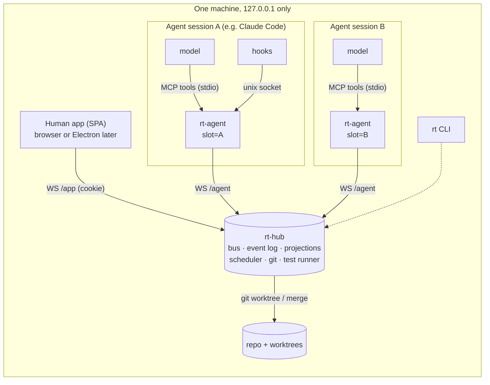
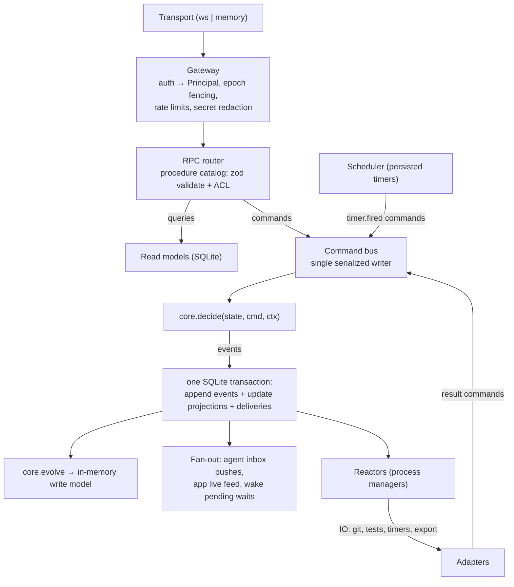
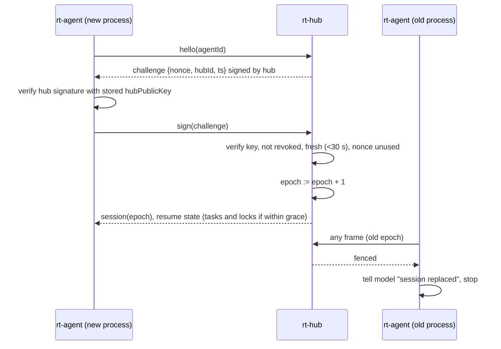
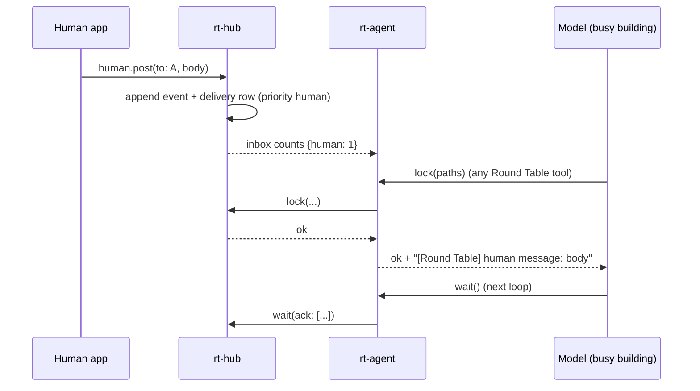
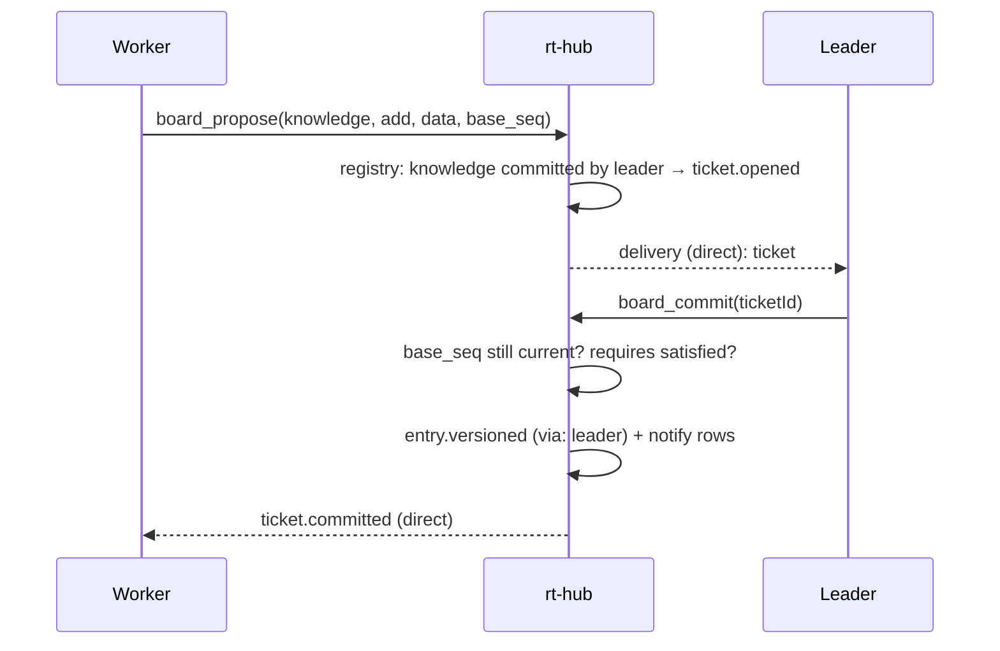
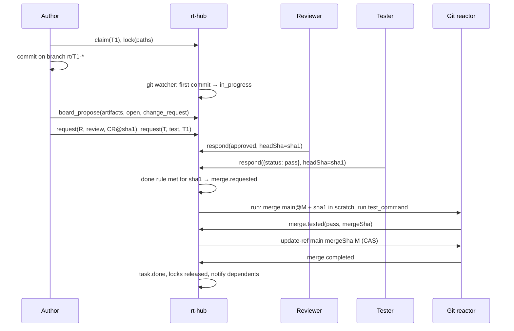
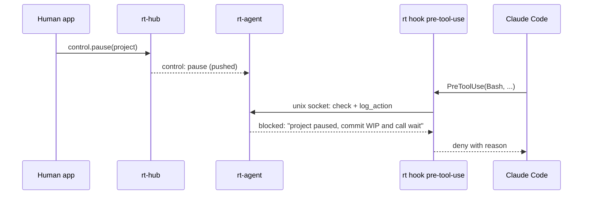

# Round Table: implementation architecture

Status: adopted 2026-09-26, together with the MVP spec freeze.
Scope: how the code is shaped. The spec ([`../SPEC.md`](../SPEC.md)) says *what* the system does; this document says *where each piece of that lives in code, and how it behaves at runtime*. When the two disagree, the spec wins, except for the deviations listed in [`spec-gaps.md`](spec-gaps.md), which the human approved.

Companion documents:

- [`spec-gaps.md`](spec-gaps.md): every place the spec meets real MCP clients, SQLite and git, and what we do there.
- [`build-plan.md`](build-plan.md): the build order (vertical slices S0–S7) that replaces the M0–M7 ordering.
- [`adr/`](adr/): one short record per architectural decision.

---

## 1. Rules for the code

These rules keep the architecture stable while features are added. A change that breaks one of them needs an ADR.

1. **The domain core is pure.** `packages/core` has no IO, no clock and no randomness. Every state change is `decide(state, command, ctx) → events | rejection`, then `evolve(state, event) → state`. Time and ids come in through `ctx`. Because of this, replay, time travel and fake-clock scenario tests work.
2. **Everything is an event.** The only way hub state changes is by appending events. Board sections, dashboards, metrics and history are projections of the log.
3. **One writer.** A single serialized command bus in the hub appends to the log. There are no locks in domain code and no cross-project races.
4. **IO sits at the edges.** Git, test runs, sockets, files and timers are adapters behind ports. They run *outside* the bus and report back by dispatching commands.
5. **The model sees a thin surface.** Anything mechanical (keys, rejoin, cursors, heartbeats, inbox counts) lives in the `rt-agent` process, not in the model's context.
6. **The registry drives behavior.** Board sections and procedures are declared once as typed data in `packages/protocol`. Routing, access checks, notify rules, validation, the MCP tool list and the app's tabs are all derived from those declarations.
7. **`project_id` is on everything.** Every event, entry, row and procedure input is scoped. Cross-project access happens only through the `system` and `repo` streams described below.

---

## 2. Processes



| Process | One per | Job |
|---|---|---|
| **rt-hub** | machine | Owns the event log, the command bus, projections, delivery, the scheduler, git and test runs. Serves `/agent` (WS), `/app` (WS), and HTTP for the static app, `/login` and `/export/*`. Binds to 127.0.0.1 only. |
| **rt-agent** | agent session | The spec's "MCP client". It is an MCP **server** (stdio, started by any MCP client) and a hub **client**. A client profile sets its wait cap, tool-list mode and briefing ([ADR-0014](adr/0014-any-mcp-client.md)). It owns the private key, auto-rejoin, the session epoch, delivery acks, the transport heartbeat, the inbox banner and the local hook socket. |
| **rt** CLI | on demand | `rt hub start`; `rt agent install --client <claude-code\|codex\|gemini\|opencode\|cursor\|vscode\|generic> --slot A --dir <path>` (writes that client's MCP config; see [ADR-0014](adr/0014-any-mcp-client.md)); `rt hook <event>` (the hook adapter entrypoint); `rt supervise` (restarts dead sessions, D3). |
| **Human app** | browser tab | A Vite + React SPA served by the hub. It uses web APIs only. It is the only way to act as the human. |

---

## 3. Inside the hub



**Command lifecycle.**

1. The gateway turns a frame into a `Principal`: `{kind: 'unpaired' | 'agent' | 'human' | 'hub', agentId?, projectId?, role?, epoch?}`.
2. The router validates the input with the procedure's zod schema and checks the principal against the procedure's `allow` list. Queries read the read models directly. Commands go to the bus.
3. The bus runs one command at a time. `decide` either rejects (a typed `Rejection`, returned to the caller, with nothing written) or returns events.
4. The events, their projection updates and their delivery rows are written in **one** SQLite transaction. After commit, the in-memory write model is advanced and the fan-out and reactors run.
5. Reactors do slow IO (running git, running tests, writing BOARD.md, scheduling timers) *outside* the bus, then dispatch result commands (`merge.completed`, `test_run.finished`, …).

**Crash isolation.** A command that throws an unexpected error rolls back its transaction. The bus appends a `project.degraded` incident on the `system` stream and keeps processing other projects. Isolation is logical (scoping plus per-command transactions), not separate threads. See [ADR-0005](adr/0005-single-serialized-writer.md).

**Write model and read models.**

- *Write model*: per-project aggregate state kept in memory (roster, tasks, locks, votes, open tickets, timers). It is rebuilt at load time from the latest snapshot plus the events after it. Archived projects are unloaded.
- *Read models*: SQLite tables (`entries`, `tasks`, `locks`, `requests`, `roster`, `deliveries`, FTS5 `search`) updated in the same transaction as the append. They can be rebuilt from the log at any time; a test rebuilds them and compares.

---

## 4. Data model

### 4.1 Streams and the event row

Every event belongs to exactly one stream:

| Stream | Holds | Why separate |
|---|---|---|
| `system` | pairing requests (before a project is chosen), agent identities and keys, projects list, global budget, degraded-project incidents | Pairing starts before a project exists; identities can span projects ("Remember"). |
| `project:<id>` | everything inside one round table | Isolation. Agents' cursors and the app's `since_seq` use this stream's `sseq`. |
| `repo:<id>` | file/module locks and worktree registry for one repo | The spec scopes locks to the repo, not the project, so two projects on one repo still conflict. |

```ts
// packages/protocol/src/event.ts
EventRow = {
  gpos: number            // global position (SQLite rowid), total order
  stream: StreamId        // 'system' | `project:${id}` | `repo:${id}`
  sseq: number            // per-stream sequence, gap-free
  projectId: ProjectId | null
  type: string            // from the event catalog, e.g. 'task.claimed'
  actor: ActorId          // agent id, 'human:<id>' or 'hub'
  role: 'human' | 'leader' | 'worker' | 'hub'
  via: 'hub' | 'leader' | 'human'   // who committed it (spec: "One writer")
  ts: number              // from ctx.now, never Date.now() inside core
  refs: Refs              // task, message, decision, request, entry ids
  payload: unknown        // validated against the event type's schema
  reason: string | null
  durability: 'durable' | 'ephemeral'
}
```

**Durable vs ephemeral** ([ADR-0006](adr/0006-durable-and-ephemeral-events.md)). Board entry versions, task state changes, decisions, votes, human actions and the audit trail are *durable* and never pruned. Chat, activity reports, `log_action`, heartbeats and tool-call logs are *ephemeral* and pruned by retention (90 days by default). A **snapshot** event, written every N events and before any pruning, holds the full write-model state, so replay and time travel still work after pruning.

### 4.2 Board: two kinds of section

The spec's 20 sections split into two kinds that behave differently in code ([ADR-0007](adr/0007-two-section-kinds-and-registry.md)):

- **Document sections** hold versioned entries using the spec's envelope (`id, section, version, author, via, created_at, supersedes, refs, tags, criticality, reason` + `data`). A change is a new version. There is one generic implementation, and each section adds only a zod schema for `data`.
- **State sections** are hub-owned aggregates with their own state machine and commands (claim, lock, request…). They show up through the same Board API but are never written by `board_propose` + commit.

The registry lives in [`packages/protocol/src/sections.ts`](../../packages/protocol/src/sections.ts):

| Section | Kind | Committed by | Leader commit requires | Default notify | Stream |
|---|---|---|---|---|---|
| goal | document | human; leader | quote of a verified human message | everyone, critical | project |
| rules | document | human; leader | passed team vote | everyone, critical | project |
| plan | document | leader; human | passed vote (explicit majority) or human approval | everyone; critical if tasks change | project |
| tasks | state | leader creates; hub moves state | — | owner, reviewer, dependents | project |
| task_log | state | hub | — | owner, subscribers | project |
| roster | state | hub | — | leader; everyone on drop | project |
| activity | state | hub | — | leader | project |
| interfaces | document | leader | agreement recorded from every affected agent | dependents, critical | project |
| decisions | document | leader; human | — | affected; everyone if team-wide | project |
| knowledge | document | leader | — | digest (critical if tagged urgent) | project |
| questions | document | leader | — | asker, blocked agents | project |
| requests | state | hub | — | requester, target | project |
| locks | state | hub | — | holder, requester on conflict | **repo** |
| artifacts | state | hub | — | reviewer, tester | project |
| quality | state | hub | — | everyone if main breaks, critical | project |
| incidents | document | hub (on any agent's proposal); leader | — | everyone + human, critical | project |
| access | document | human | — | agents it grants | project |
| budgets | state | hub | — | leader; human at 80% | project + system (global ceiling) |
| human_inbox | document | leader; hub (pairing, budget, risky-action gates) | — | human | project + system |
| digest | document | leader | — | everyone, digest priority | project |

`incidents` is the one case where the spec says "any agent" writes. In code, the agent *proposes* and a hub rule commits it immediately, with the agent recorded as `author` and `via: 'hub'`. That keeps "only hub, leader and human commit" true.

**Criticality (D10).** Each section's notify rule sets the default priority. Raising it is a command any agent can issue (with a reason); lowering a critical entry is a human-only procedure.

### 4.3 Tasks, change requests and the done rule

```
proposed → ready → claimed → in_progress → in_review → in_test → done
                         (blocked, cancelled reachable from any non-terminal state)
```

The hub moves every transition except `done` from facts it sees (claim, first commit on the task branch seen by the git watcher, change request opened, review requested…). A task becomes `done` only through the **done rule** ([ADR-0008](adr/0008-local-git-host-and-change-requests.md), [ADR-0009](adr/0009-hub-runs-tests.md)):

1. A **ChangeRequest** exists for the task: `{id, taskId, branch, base: 'main', headSha, author}`. An agent opens it with `board_propose('artifacts', 'open', {kind: 'change_request', taskId, branch})`, and the hub reads `headSha` from git.
2. A review `respond(..., 'approved')` from an agent ≠ author, **for this `headSha`**.
3. A test `respond(..., {status: 'pass'})` from an agent ≠ author, **for this `headSha`**.
4. The **hub's own test run** passes on the *merge result* of `main@M + headSha`, in a scratch worktree, using `rules.test_command`.
5. Compare-and-swap: `git update-ref refs/heads/main <merge> <M>`. If main moved, go back to step 4 against the new main. If the merge conflicts, the CR returns to the author with `rebase_needed`.

A new push to the branch changes `headSha` and invalidates steps 2–4 for the old sha, so a stale approval can't merge new code.

**As built in S2.** The router reads the branch head from git before `board_propose('artifacts', …)`, `request` and `respond` reach core, so core sees `headSha` and `currentHeadSha` as plain facts. A verdict for an older head is rejected with `stale_head`, and a task in `in_test` goes back to `in_review`. `merge.requested` is emitted once per head. The merge reactor merges main + head in a scratch worktree, runs `rules.testCommand` there, and moves main with `git update-ref <new> <old>`, retrying if main moved. `merge.result` records the run in `quality` and marks the task done only if the done rule holds at the merged head. Agents work in their own worktrees (`rt agent install --repo`), detached at main, one branch per task.

### 4.4 Delivery (messages, notifications, `wait`)

Each event may produce **delivery rows** `(projectId, agentId, sseq, priority, acked)`, computed in the append transaction from:

1. explicit addressing (`send(to=…)`, requests, replies),
2. the registry's notify rule for the entry's section and criticality,
3. the agent's `board_subscribe` subscriptions (sections, ids, file paths, tags) (D2),
4. control messages (pause, resume, stop, dismiss), always at `human` priority.

`wait` returns unacked rows ordered by priority (`human > critical > direct > normal > digest`), then `sseq`, capped by a size budget (about 2k tokens), with "N more pending". `rt-agent` acks what it handed to the model on its next call, so delivery is at-least-once. The model never handles a cursor ([ADR-0001](adr/0001-piggyback-delivery.md)).

A pending `wait` resolves **immediately** on a `human` or `critical` row, after a short coalescing window (~2 s) for `direct` and `normal`, and on timeout otherwise. The timeout is capped at 50 s by default, because MCP SDK clients time out requests at 60 s; S0 checks whether progress notifications let it grow.

**Inline delivery (as built in S1).** When the pushed counts show human or critical items, rt-agent runs a zero-timeout `wait` itself after the model's tool call and appends the items under `[Round Table] messages for you:`, so they count as handed over and are acked on the next call. The banner subtracts items already handed over but not yet acked.

**Piggyback.** The hub pushes inbox counts to `rt-agent` over the transport whenever they change. `rt-agent` appends a one-line banner to **every** Round Table tool result (`[Round Table] inbox: 3 messages waiting (1 human, 2 critical). Read with wait.`), a factual line defined in the MCP server instructions (S0), and puts `human`/`control` items inline. This is how an agent that is busy working, and not waiting, still sees the human first.

### 4.5 Identity, sessions, liveness

- **Identity slots** ([ADR-0003](adr/0003-identity-slots-and-auto-rejoin.md)). `rt-agent --slot A` keeps `$RT_HOME/identities/<hubId>/A.json` (0600): `{agentId, privateKey (pkcs8), hubPublicKey}`, behind a `KeyStore` port. The MVP ships a file store; an OS keychain backend comes later ([ADR-0012](adr/0012-security-boundary-and-threat-model.md)). On startup, if the slot has an identity, `rt-agent` runs the challenge-response rejoin *before* the first tool call. The model is only involved in first-time pairing (`join_request`, then pasting the code into `join_confirm`).
- **Epoch fencing** ([ADR-0004](adr/0004-session-epoch-fencing.md)). Each successful auth increments the agent's `epoch`. Frames from a lower epoch get `fenced`, and that `rt-agent` tells its model "this session was replaced" and stops. The spec's "two live sessions → pause both" fires only on **ping-pong**: a fenced key re-authenticating more than 3 times in 2 minutes.
- **Liveness vs attention** ([ADR-0002](adr/0002-liveness-vs-attention.md)).
  - *Connection liveness* comes from transport pings sent by the `rt-agent` process every 15 s. A dropped socket makes the agent `disconnected`. It becomes `stale` after 3 min without a connection, and `gone` after the 10-minute grace period, followed by F10 cleanup.
  - *Attention* is the time since the model last called a tool, counting hook-reported tool calls too. More than 15 min (configurable) produces a `roster.inattentive` event, and the leader pings the agent. A model running a long build is never marked stale.
  - *Activity freshness*: if more than 5 min pass without `activity()`, `rt-agent` adds "activity report due" to the banner.

### 4.6 Timers

All timers are events: `timer.scheduled {id, dueAt, command}` and `timer.cancelled`. The Scheduler adapter watches the earliest due time and dispatches the stored command. Timers survive restarts, and tests drive them with `FakeClock` ([ADR-0010](adr/0010-scheduler-and-injected-clock.md)).

| Timer | Default | Fires |
|---|---|---|
| pairing code expiry | 5 min | `pairing.code_expired` |
| join request expiry | 10 min | `pairing.request_expired` |
| rejoin challenge freshness | 30 s | (checked in `decide`, not scheduled) |
| stale after disconnect | 3 min | `roster.mark_stale` |
| grace period | 10 min | `roster.mark_gone` → F10 cleanup |
| attention | 15 min | `roster.inattentive` |
| critical ack | 2 min | leader re-send, then `unresponsive` |
| vote window | 5 min | `vote.close` |
| human question default | per question | `question.apply_default` (low-risk only) |
| lock inactivity | 30 min | `lock.expire` |
| task time budget | 45 min | `budget.hit` → pause task + ask_human |
| project auto-pause | per settings | `project.auto_pause` |

### 4.7 Cross-project concerns

- **Locks** are commands on the `repo:<id>` stream. A conflict returns the holder and the holder's project.
- **Global budget** is kept on the `system` stream. When a project's usage event pushes the global total past the ceiling, the bus appends `system.paused_all`, which fans out `control: pause` to every project.
- **History** (`history_search`, `history_get`) reads durable read models of other projects: knowledge, decisions and retros only, never messages. Anything carried over is a human action that creates new entries in the target project, with provenance refs.

---

## 5. Procedure catalog

All operations, whether called by agents over MCP or by the human app, are **procedures** declared in [`packages/protocol/src/procedures.ts`](../../packages/protocol/src/procedures.ts): `{name, kind: 'command' | 'query', allow: Principal[], input, output, stream}` ([ADR-0011](adr/0011-procedure-catalog-over-rest.md)). MCP tools are generated from the procedures marked `mcp: true`. The app calls the same procedures over `/app`. HTTP exists only for static files, `/login` and exports.

| Procedure | Allowed | Kind | Stream | Notes |
|---|---|---|---|---|
| `join_request` | unpaired | command | system | returns requestId, hub public key, match phrase |
| `join_confirm` | unpaired | command | system → project | signed by the new key; code bound to request + key + project |
| `rejoin` | unpaired | command | system | normally automatic in rt-agent; still exposed as a manual retry |
| `session.challenge`, `session.prove` | unpaired | command | system | rt-agent internal (not MCP): the two steps of rejoin |
| `control.ack` | worker, leader | command | project | rt-agent internal: sent once the model has seen a critical alert or control message (F7) |
| `change_request.get` | worker, leader, human | query | project | one CR with its approvals, tester results and hub runs |
| `leave` | worker, leader | command | project | F10 graceful cleanup |
| `send` | worker, leader | command | project | `to`: all / channel / ids; the hub stamps sender and role |
| `wait` | worker, leader | query + ack | project | see §4.4 |
| `activity` | worker, leader | command | project | ephemeral |
| `board_view`, `board_read`, `board_get`, `board_history`, `board_search` | worker, leader, human | query | project | size-capped; `board_view('onboarding')` for mid-run joiners |
| `board_propose` | worker, leader | command | project | creates a ticket; routed by the registry |
| `board_subscribe` | worker, leader | command | project | D2 |
| `claim`, `release` | worker | command | project | atomic |
| `lock`, `unlock` | worker | command | repo | returns holder + project on conflict |
| `request`, `respond` | worker | command | project | review / test / info / notify_on_done; review and test responses carry `headSha` |
| `ask_human` | worker, leader | command | project | the asker's task becomes blocked right away; the leader merges duplicates into `questions` |
| `vote` | worker | command | project | only agents active when the vote opened are counted |
| `log_action` | worker, leader | command | project | ephemeral; also fed by the hook adapter |
| `raise_criticality` | worker, leader | command | project | D10, needs a reason |
| `board_commit`, `board_reject` | leader | command | project | enforces the "requires" column of the registry and `base_seq` (D5) |
| `broadcast_critical`, `open_vote`, `summarize`, `dismiss` | leader | command | project | |
| `history_search`, `history_get` | leader, human | query | system | durable read models only |
| `project.create / archive / delete / pin` | human | command | system | |
| `repo.attach` | human | command | system + project | the hub checks it is a git repo with the main branch, and warns if main is checked out |
| `goal.set`, `rules.edit`, `access.grant / revoke`, `plan.approve / reject` | human | command | project | |
| `inbox.answer`, `decision.override`, `criticality.lower` | human | command | project | |
| `control.pause / resume / stop` | human | command | project or system | scope: agent, project or all |
| `pairing.allow / deny / block_origin / remember` | human | command | system | allow picks the project and returns the one-time code |
| `leader.assign`, `agent.remove`, `key.revoke / rotate` | human | command | system + project | |
| `human.post` | human | command | project | composer; always human priority |
| `leader_chat.send` | human | command | project | |
| `settings.update` | human | command | project or system | |
| `logs.query`, `board.at(seq)`, `metrics.query`, `export` | human | query | project | `board.at` replays from the nearest snapshot |

The leader-only tools appear in the agent's tool list only after the role is known: `rt-agent` sends `notifications/tools/list_changed` ([spec-gaps #12](spec-gaps.md)). The hub checks the principal on every call regardless.

---

## 6. Sequence diagrams

### 6.1 Pairing

```mermaid
sequenceDiagram
  participant M as Model (agent chat)
  participant A as rt-agent
  participant H as rt-hub
  participant U as Human app
  M->>A: join_request(name, tags, capabilities)
  A->>A: generate Ed25519 key (slot has none)
  A->>H: join_request(..., publicKey)
  H-->>A: requestId, hubPublicKey, matchPhrase
  A-->>M: "Show the human: amber-falcon-42"
  H-->>U: pending request (phrase, origin, fingerprint)
  U->>H: pairing.allow(requestId, projectId)
  H-->>U: one-time code (8 chars, 5 min)
  Note over U,M: human pastes the code into the agent's chat
  M->>A: join_confirm(requestId, code)
  A->>H: join_confirm(requestId, code, sig)
  H->>H: check code, key, attempts; bind key → agentId
  H-->>A: agentId, role, onboarding view
  A->>A: store identity in slot; list_changed if leader
  A-->>M: onboarding view + loop instructions
```

### 6.2 Auto-rejoin with fencing



### 6.3 Human message reaching a busy agent



### 6.4 Proposal → commit



### 6.5 Task to merge



### 6.6 Pause with the hook adapter



Without the hook adapter, the pause reaches the model at its next Round Table tool call (piggyback).

---

## 7. Human app

- **Data layer**: one `LiveClient` over the Transport calls procedures and subscribes to per-project change feeds. A normalized store is keyed by id, and views are selectors over it. Every id is rendered by one `<Ref id>` component that opens the detail drawer, so there is no dead text.
- **Live updates**: the hub pushes `{projectId, sseq, type, refs}` notices. The store refetches the affected queries (or applies small payloads directly).
- **Time travel**: `board.at(projectId, seq)` is computed on the server from the nearest snapshot plus replay. The client never replays.
- **Auth**: on first start the hub prints a one-time login URL (`/login?t=…`), which sets an HttpOnly, SameSite=Strict cookie. `/app` requires that cookie and checks the `Host` header (127.0.0.1:port) and `Origin` header to block DNS rebinding and cross-site calls.
- **No Electron APIs**. Everything uses web APIs.

---

## 8. Client adapters (hooks)

The first adapter targets Claude Code hooks. `rt agent install` writes `PreToolUse` and `PostToolUse` hooks that run `rt hook <event>`. The hook talks to its **own slot's rt-agent** over a unix socket (`$RT_HOME/run/<slot>.sock`), not to the hub directly, so it needs no key of its own. The adapter:

- forwards every tool call as `log_action` (source: `client-hook`), which also counts as attention;
- returns `deny` while the agent's task or project is paused, or when a destructive-command pattern matches and no human approval is on record;
- **fails open** when rt-agent isn't running, and logs locally that it did.

---

## 9. Invariants (each becomes a test)

1. No event with `section ∈ {document sections}` has `via` other than `hub`, `leader` or `human`, and none is produced by a procedure an agent principal can call directly (catalog walk).
2. Rebuilding every read model from the log gives byte-identical tables.
3. Replaying a project's events up to `seq` gives the same board as `board.at(seq)`.
4. No event in `project:X` references an entity of `project:Y`.
5. `task.done` is only ever appended with a CR whose approval, tester pass and hub test run all name the same `headSha`, and with reviewer ≠ author and tester ≠ author.
6. At most one live epoch per agent id accepts writes.
7. `core` imports nothing from `node:*` or IO packages, and `Date.now` or `Math.random` never appear in `core` (lint).
8. Every human-callable procedure on a project or repo stream takes `projectId` in its input. Agent calls are scoped by their session's project, and the router rejects a `projectId` that doesn't match it.

---

## 10. Threat model

([ADR-0012](adr/0012-security-boundary-and-threat-model.md))

**In scope (protected):** a confused or prompt-injected agent trying to act as the human, approve its own work, write the board directly, forge "the human said" messages, admit other agents or reuse a sniffed rejoin. All of these are blocked by principals, the procedure ACL, epoch fencing, signed challenges and the verified human-message quotes.

**Out of scope for the MVP, stated plainly:** an agent that runs shell commands **as the same OS user** as the hub can read the hub's SQLite file, the identity files and the human session cookie store. Nothing inside a single user account can stop that. The documented mitigation is to run `rt-hub` as a separate OS user, with its data dir at 0700. The hook adapter can deny obvious access to `$RT_HOME` paths, but that is best effort.

**Secrets:** the gateway runs every inbound text through the redactor before `decide`. `access` entries hold references only, never secret values.

---

## 11. Code layout

```
packages/
  protocol/  frames, Transport (+ memory, ws), event row, entry envelope,
             section registry, procedure catalog, ids
  core/      pure domain: ports (Clock, IdGen), decide/evolve modules:
             projects, pairing, roster, messaging, board, tasks, locks,
             requests, votes, budgets, timers
  hub/       IO shell: gateway, router, bus, Store (node:sqlite), projectors,
             deliveries, reactors, scheduler, GitHost, TestRunner, http, auth
  agent/     rt-agent: MCP stdio server, KeyStore, identity slots, auto-rejoin,
             delivery acks, piggyback banner, hook socket, prompts
  cli/       rt command
  app/       human app (Vite + React)
  testkit/   FakeClock, scripted fake agents, scenario DSL (core-level and
             hub-over-memory-transport)
```

**Dependency rule** (checked by `pnpm check:deps`):

```
protocol  ←  core  ←  hub  ←  cli
protocol  ←  agent ←  cli
protocol  ←  app
testkit   →  protocol, core, hub, agent
core      →  no node:*, no IO packages, no Date.now / Math.random
protocol  →  browser-safe except src/ws.ts (import it as @round-table/protocol/ws)
```

**Runtime**: Node 24 LTS (CI also runs Node 26), TypeScript strict with `erasableSyntaxOnly`, so Node runs the sources directly through type stripping and the packages need no build step. pnpm workspaces. zod 4 for every schema.
